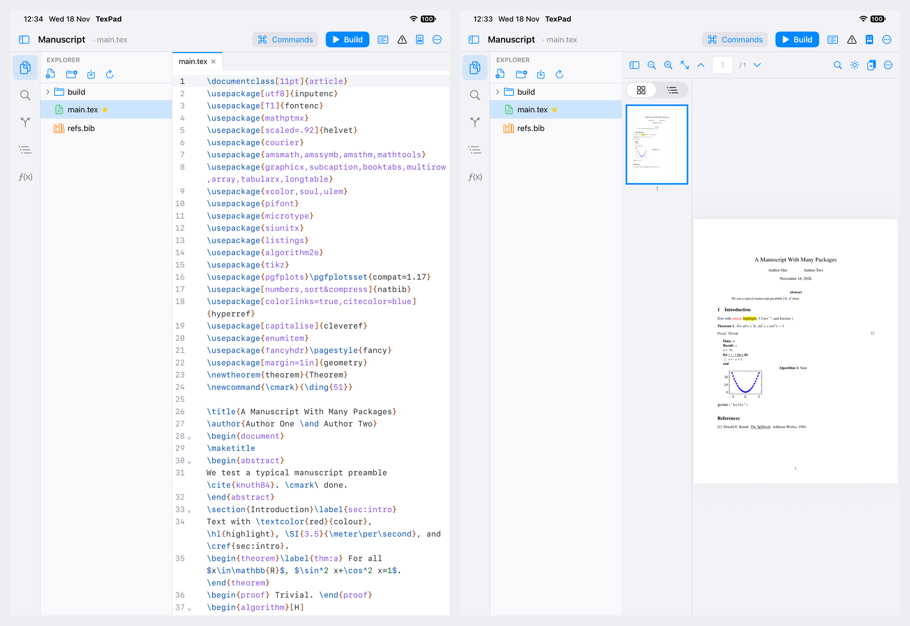

# TexPad

A free, offline LaTeX IDE for iPad. It compiles on the device — no server, no network.

<p align="center"></p>

- **Engine:** pdfTeX (SwiftLaTeX WebAssembly build) in a hidden `WKWebView`, with a bundled TeX Live subset served through a `tex://` URL scheme.
- **Editor:** CodeMirror 6 (syntax highlighting, folding, bracket matching, LaTeX autocomplete, find/replace, multi-cursor) in a `WKWebView`.
- **UI:** SwiftUI, VS Code-style — activity bar, explorer, tabs, PDF preview, problems panel, command palette (⇧⌘P), quick open (⌘P).

## Features
- Open any folder from Files (security-scoped bookmarks, recent projects), create/rename/move/delete/import files, drag & drop in the explorer.
- Multi-file projects (`\input`, `\include`, images, `.bib`), `% !TEX root = …`, main-file setting (`.ipadtex.json`).
- Build (⌘B) with **selectable build recipes** — pdfLaTeX or XeLaTeX, BibTeX, automatic reruns, or your own step list (Settings → Build recipes). Only changed files are re-sent to the engine; optional build-on-save. `% !TEX program = xelatex` picks XeLaTeX automatically.
- **XeLaTeX** with fontspec, unicode-math and Unicode text, using the bundled Latin Modern, TeX Gyre, Libertinus and STIX Two fonts (iOS system fonts aren't reachable; add your own `.otf/.ttf` to TexPad/TeXExtras).
- Problems panel with click-to-jump, inline squiggles and gutter markers.
- Autocomplete: commands, environments (auto `\end`), `\usepackage`, `\documentclass`, `\cite` (from `.bib`), `\ref`/`\eqref` (from `\label`), `\input`/`\includegraphics`/`\bibliography` paths, math symbols, TikZ libraries.
- **Git** (HTTPS + personal access token): clone, initialize, status, stage/unstage/discard, commit, branches, fetch, fast-forward pull and push, with a Source Control sidebar, branch name in the status bar, and tokens in the iOS Keychain. Not yet: history/diff view, merge conflicts, stash, SSH.
- Outline, project-wide search/replace, snippet and symbol palette, extra-key bar above the soft keyboard.
- PDF preview with page controls, thumbnails and outline sidebar, fit width/page, single/continuous/two-page layout, dark PDF mode, find in PDF, print, save to Files, and a remembered position per project (the last build's PDF is shown when you reopen a project).
- Best-effort PDF ↔ source jumps (double-tap text in the PDF; "To PDF" button) based on text matching.

## Limitations
- pdfLaTeX, XeLaTeX and BibTeX only (no biber, makeindex, LuaTeX). The engines stop at the first TeX error.
- No SyncTeX (the bundled engine doesn't produce it) — jumps are text-based guesses.
- Only the packages in `texlive/` are available. Put extra `.sty`/`.cls` files in your project folder and they are picked up automatically.
- The root `.tex` file's folder is the working directory; paths are relative to the project root.

## Build from source
Requirements: Xcode 26+, [XcodeGen](https://github.com/yonaskolb/XcodeGen) and CMake (`brew install xcodegen cmake`), Node 20+ only if you change the editor.
The repository holds source only; the TeX Live subset and fonts (~400 MB) and libgit2 are fetched or built by scripts.

```sh
tools/build-libgit2.sh         # libgit2 from source -> Vendor/libgit2.xcframework (pinned commit, ~1 min)
tools/fetch_bundle.sh          # prebuilt TeX bundle -> texlive/ + fonts/ (SHA-256 pinned in tools/bundle.conf)
cp Config/Local.xcconfig.example Config/Local.xcconfig   # put your own Team ID in it
xcodegen generate              # creates TexPad.xcodeproj from project.yml
open TexPad.xcodeproj          # set your Team under Signing & Capabilities, then Run
```

No bundle download? If you have MacTeX/TeX Live installed you can build the same folders yourself instead of `fetch_bundle.sh`:
`tools/seed_texlive.sh && python3 tools/seed_texlive_extra.py && python3 tools/close_deps.py && python3 tools/seed_fonts.py`.
To rebuild the editor bundle after changing `editor-src/`: `(cd editor-src && npm ci && node build.mjs)`.
Maintainers: `tools/make_bundle.sh <dir>` packs `texlive/` + `fonts/` for a GitHub Release; put its URL and hash in `tools/bundle.conf`.

Free Apple ID builds: change `PRODUCT_BUNDLE_IDENTIFIER` in `project.yml` to one of your own; builds expire after 7 days and must be reinstalled.

## Install on your iPad
You need a Mac with Xcode and an iPad (iPadOS 17+). A free Apple ID is enough.

1. Do the **Build from source** steps above (libgit2, TeX bundle, `Local.xcconfig` with your Team ID, `xcodegen generate`).
   Find your Team ID in Xcode → Settings → Accounts, or after step 4 in Signing & Capabilities.
2. In `project.yml` change `PRODUCT_BUNDLE_IDENTIFIER` (and the tests' id) to something unique to you, e.g. `com.yourname.texpad`, then run `xcodegen generate` again.
3. On the iPad: Settings → Privacy & Security → **Developer Mode** → on (it restarts the iPad). Connect it to the Mac with a cable and tap *Trust*.
4. Open `TexPad.xcodeproj`, select the **TexPad** target → Signing & Capabilities → pick your Team (add your Apple ID under Xcode → Settings → Accounts if needed).
5. Choose your iPad as the run destination (top bar) and press **⌘R**. The first install copies ~400 MB, so give it a minute.
6. If the iPad says *Untrusted Developer*: Settings → General → VPN & Device Management → your Apple ID → **Trust**. Then open TexPad.

After installing you can unplug; the app runs fully offline. With a free Apple ID the app **expires after 7 days** (and you can have at most 3 sideloaded apps): plug the iPad in and press ⌘R again to renew it. Your projects live in Files, not in the app, so they are untouched. A paid developer account ($99/yr) extends this to a year.

Developer scripts (simulator):
- `tools/run-sim.sh [Sample] [seconds] [screenshot.png]` — build, launch, optionally open a bundled sample and screenshot.
- `tools/make_icon.py` — regenerates the app icon (needs Pillow).
- `tools/autotest.sh <project dir> [main.tex]` — headless build of a folder; prints parsed diagnostics. Missing TeX files are copied from your local TeX Live (`tools/fetch_tex_files.py`) so the bundle converges.
- `xcodebuild test -scheme TexPad …` — unit tests (log parser, BibTeX parser, index, search, sync matching).

The first launch builds the LaTeX format file (a few seconds) and caches it.

## License
TexPad is free software under the **GNU Affero General Public License v3.0** (see [LICENSE](LICENSE)). The AGPL covers TexPad's own source and the bundled
SwiftLaTeX engine; if you distribute a modified TexPad (including to users of a hosted or sideloaded build) you must offer them the corresponding source.
Third-party components keep their own licenses — see [THIRD_PARTY.md](THIRD_PARTY.md). Security notes and the threat model are in [SECURITY.md](SECURITY.md).

Distribution note: the AGPL is not compatible with the App Store's terms unless you hold the copyright to all of the AGPL code, so TexPad is meant to be
built from source, sideloaded, or shared through TestFlight / AltStore.

## Contributing
See [CONTRIBUTING.md](CONTRIBUTING.md).
